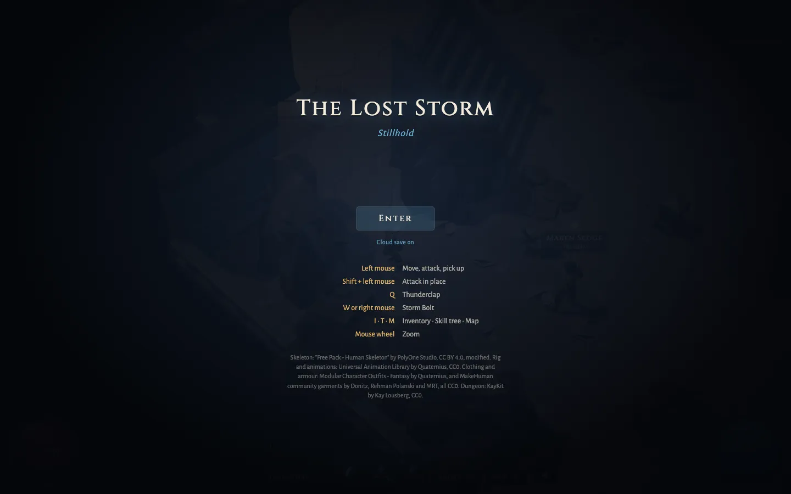
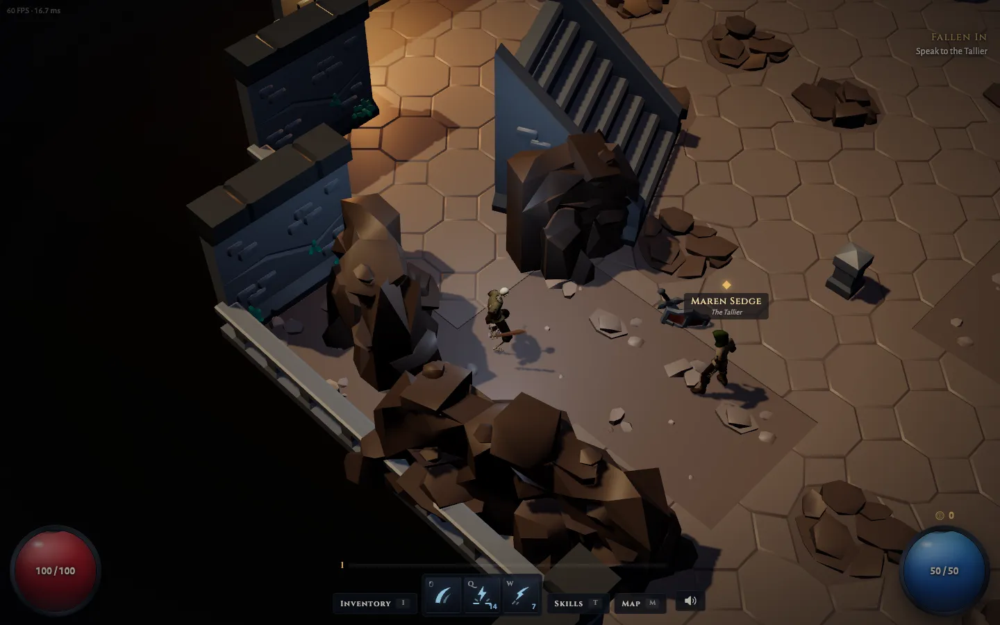
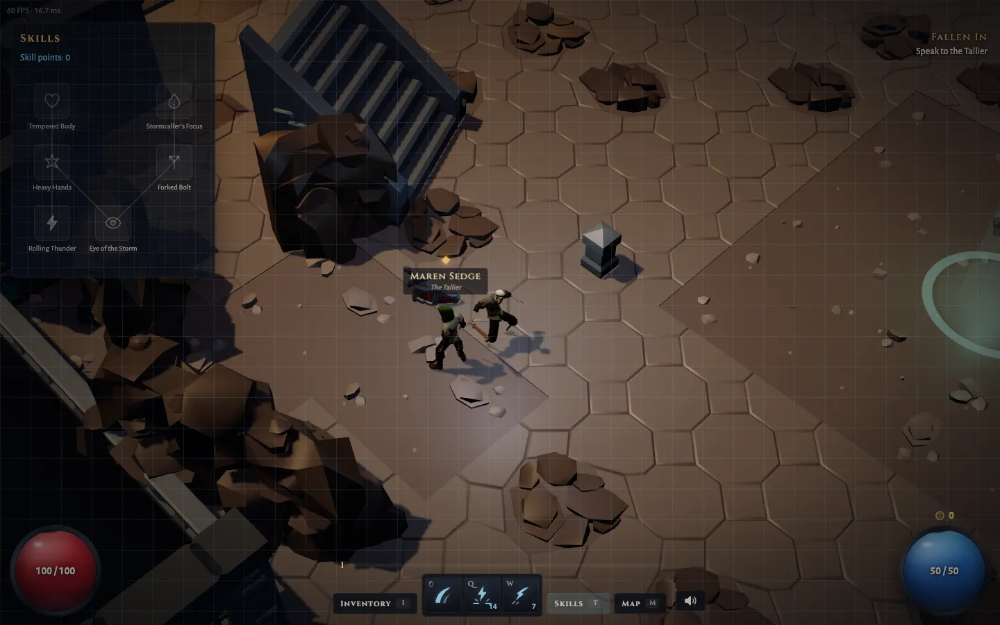

# The Lost Storm

## Play it now: [theloststorm.com](https://theloststorm.com)

Free, in your browser, on a computer or a phone. Nothing to install and no account needed: open [theloststorm.com](https://theloststorm.com) and press play.

[](https://openwebarcade.com/games/the-lost-storm)

The Lost Storm is an isometric action RPG. You wake in a white mist with a worn journal lying nearby, and walk out into a hall under a night storm, where lightning leaves pockets of somewhere else on the black rock and what is inside them turns on you. Fight, find loot, level up, and shape your character on a skill tree of 125 places. You fight alone; the Hideout, the chat, trading and the auction house are shared with everyone else who is playing. The game is in alpha and changes daily.

It is built with Three.js, TypeScript and Vite, with no game engine on top, and all of it is in this repository.







## Run it on your own machine

You only need this to change the game or to look at how it works. To play, use [theloststorm.com](https://theloststorm.com).

```bash
npm install
npm run dev
```

You need Node 22.18 or later. Open http://localhost:5193/play/ for the game. A plain clone runs offline and silent: the shared Hideout, chat, trading, the auction house and the ladder need a server (see below), and the sounds are served separately (see Sound). http://localhost:5193/ is the landing page: a static page with its own small entry (`index.html`, `src/landing/`) that loads no Three.js. The game's page is `play/index.html`. With `VITE_SERVER_URL` set, the landing page shows how many players are online and the top of the ladder from `GET /v1/leaderboard`; without it, it makes no request and shows neither.

The build writes `sitemap.xml` and `robots.txt` from the page list in `tools/site/crawl.ts`. Each page's title, description, canonical address, share tags and JSON-LD come from `tools/site/head.ts` (the guide's from the same step that renders it); `privacy.html` and `terms.html` are `noindex`. A file put at the root of `public/`, such as a search engine's verification page, is served as is.

### Controls

These are the default bindings (`src/settings/bindings.ts` and `skillBar` in `data/player.json`). On a phone the game has touch controls instead.

| Input | Action |
|---|---|
| Left mouse | Move, attack the monster under the cursor, pick up loot, talk to the character under the cursor, travel through the exit under the cursor. Hold to keep going |
| Shift + left mouse | Attack in place |
| Q, W (or right mouse), E, R | The abilities on the bar. The slots start empty; each ability you earn is a choice of two or three, and goes on the bar |
| Space | Dodge roll, once you have learned it |
| 1, 2 | Life and mana flasks |
| I / C / T / M | Inventory / character sheet / skill tree / world map |
| Tab | Corner minimap, or the large map laid over the game (clicks still reach the game) |
| L | The ladder (only with a server) |
| Alt (hold) | Show the names of items on the ground |
| F3 | Frame rate |
| Mouse wheel | Zoom; over the minimap, minimap zoom |
| Left mouse, Space or Enter in a conversation | Next line |
| Enter | Type in the chat (only with a server) |
| Escape | Close panels, leave a conversation; with nothing to close, open the menu (Back to the game, Settings, Feedback, Back to lobby). The world keeps going while it is open |

In the bag, left mouse wears an item and right mouse drops it. Click the Warden Trader or the stash chest in the Hideout to open the stall or your stash beside the bag: at the stall, left mouse on its goods buys one (or buys back one you sold) and right mouse on a bag item offers it for sale; with the stash open, a bag item goes into the stash and a stash item comes back. Walk away or press Escape to close. Shift-click or right-click several bag items at the trader (hold each item on touch), then sell the selection for the displayed gold total. In Settings → Loot, pick a rarity preset or choose slots for each rarity. Slot matches have a diamond beside their ground name. The Warden Porter in the Hideout charges 100 gold for one real-time hour and collects matching equipment in a personal 24-slot satchel. Speak to the porter to take items, including after the hire ends. Settings also has Graphics (quality preset, FPS), Sound and Controls, where every keyboard action can be rebound; the left mouse button, Shift and Enter are fixed.

Progress saves to `localStorage` on its own, including the zone you are in and where you last arrived or touched a checkpoint; dying returns you there.

The game is in alpha. In now: the In-Between, where you wake; the Hall of Time; the Hideout off the Hall, with its fire, a trader, an auctioneer, a stash and a waypoint; and the Last Gate, a boss lair that opens at level 8. Two heroes to choose from, a skill tree, loot with affixes, and levels.

## Cloud save and the shared world (optional)

The game never needs a server. Progress saves to `localStorage`, and a plain clone makes no network request.

To keep a cloud copy of the character, point the client at a compatible save server with `VITE_SERVER_URL`:

```bash
VITE_SERVER_URL=http://localhost:8787 npm run dev
```

With the variable set:

- On first run the game creates a guest account on that server and keeps its token in `localStorage`, bound to that server's address. A guest account belongs to the browser that created it, so until the player signs in the cloud copy is a backup for this browser and does not follow them to another browser. Clearing only the save (`the-lost-storm.save.v1`) or using "Start over" keeps the link to the cloud copy. Clearing all site data removes the token too: the next start creates a new guest account and the old cloud copy is left behind.
- On load it takes the newer of the local and the cloud save. If both changed since they last met, the one with the higher level, then the higher experience, wins. The browser console says which one was kept and why.
- Every local save is also pushed in the background and retried quietly. A slow, missing or misbehaving server never fails the game. When a server asks for a wait with `Retry-After`, the client honours it only if the server exposes that header to browsers (`Access-Control-Expose-Headers: Retry-After`); otherwise it backs off on its own. At start the game waits three seconds at most for the cloud copy, which loads alongside the characters, and "Start over" waits up to three seconds for the cloud before it reloads.
- "Start over" resets the cloud copy as well.

Set `VITE_BUILD_ID` at build time to name the client version, for example the commit (`VITE_BUILD_ID=$(git rev-parse --short HEAD) npm run build`). Feedback sent from the game carries it so each note can be traced to a build. Unset, or not 1 to 40 letters, digits, dots, dashes and underscores, it reads `dev`.

If the server offers it, the title screen signs in with a code sent by email, or with Google's sign-in button under the cloud line. Signing in as a guest keeps the character: the server links Google to the same account. Signing in on another browser switches that browser to the account, and the account's cloud save is loaded there (a browser whose account has no cloud save yet uploads its own). "Sign out" forgets the account and this browser's copy of the save and starts a fresh guest; it waits until the latest progress has reached the cloud. The page reloads after signing in or out. Google's script is loaded only when the server says sign-in is on, and nothing from Google is requested otherwise.

With a server the title screen also shows the ladder beside the title: the top ten characters (rank, name, level, a dot for players online now), how many are online, the latest level-ups, and the player's own line. A player without a chosen name is asked for one there; until then the server gives a generated two-word name. In game, L opens the same ladder with the player's row pinned, and a short note appears when the player passes someone. The ladder refreshes every 30 seconds on the title screen, every minute in game and when the tab regains focus; it never stops the game when the server is away. Its protocol types are in `src/backend/api.ts` with the others, and its readers in `src/backend/lobby-api.ts`. To show the compact ladder on another page, call `mountCompactLeaderboard(root)` from `src/lobby/compact.ts`.

With a server the game is also shared. Standing in the Hideout shows the other players there; the chat (General for everyone online, whispers with `/w <name>`) stays open in every zone; another player's menu offers a message, a trade, a friend request, mute, block and report; and the Warden Auctioneer in the Hideout lists items for everyone. All of it goes through one connection in `src/backend/live.ts`, whose frames are read by `src/backend/live-protocol.ts`. Other players are scenery to the renderer: `sim/` never hears of them.

The title screen shows "Cloud save on" or "Offline". Without the variable it always says "Offline". The requests the client makes, and the answers it accepts, are the types in `src/backend/api.ts`.

## Checks

Run these before every pull request; each must pass with zero errors and zero warnings:

```bash
npm run typecheck
npm run lint
npm run test:affected
```

`npm run typecheck` is strict TypeScript, `npm run lint` is oxlint with type information (rules in `.oxlintrc.json`), and `npm run test:affected` runs only the tests a branch can affect with Node's test runner. `npm test` runs the whole suite split over a few processes, `npm run test:isolated` runs it with one process per file, and `npm run check` runs typecheck, lint and the whole suite. `npm run build` makes the production bundle in `dist/`. CI runs typecheck, lint and the affected tests on every pull request, and the whole suite in the merge queue and on `main`. [CONTRIBUTING.md](CONTRIBUTING.md) has the rest.

### Portal build (itch.io, Game Jolt)

```bash
npm run build:portal
```

This makes the offline build for game portals that host an uploaded HTML5 zip: the folder `dist-portal/` and the zip `the-lost-storm-portal.zip` at the repository root. The game page is `index.html` at the root of the zip, beside `assets/` (the bundle and fonts), `models/` and `textures/`, and every URL in it is relative, so it runs from any sub-path, inside a portal's iframe on its own domain. The landing page, the guide, `og.jpg`, the sitemap and `robots.txt`, and every `.html` file at the root of `public/` (`privacy.html`, `terms.html`, a search engine's verification file) are left out; the Guide, Privacy and Terms links on the title screen open those pages on theloststorm.com in a new tab.

It is always the offline build: it ignores `.env` files and stops if `VITE_SERVER_URL` or `VITE_ASSET_BASE` is set in the shell. It makes no network request, saves to the browser's `localStorage` (a portal's iframe keeps that save apart from the one on theloststorm.com), and plays without sound. The shared Hideout, chat, trading, the auction house, the ladder, sign-in and feedback are not in it. Local-only assets in `public/models/local/` and `public/audio/local/` never go in. The script prints the file count and total size, and fails if the build is over itch.io's limits: 1,000 files, 500 MB in all, 200 MB for one file.

### GamePix build

```bash
npm run build:gamepix
```

The same offline build for a host that forbids any address outside its own domain: the folder `dist-gamepix/` and the zip `the-lost-storm-gamepix.zip`. It is the portal build with these differences, all made at build time by the Vite mode `gamepix` (`GAMEPIX` in `tools/portal.ts`):

- No link out. The Guide, Privacy and Terms row, the Discord and GitHub links, the pause menu's links and the end card's links and Copy link button are absent, as are the canonical, Open Graph and Twitter tags in the page head.
- No sign-in code. `GAMEPIX.swaps` replaces modules with quiet ones beside them (`src/keep/keep-start.ts` by `keep-start-none.ts`, and so on), so the Google sign-in and Turnstile addresses are not in the bundle, and the sign-in block is not in the page.
- No "Turn your phone sideways" prompt, no landscape lock and no fullscreen request; the game plays in portrait and landscape.
- The world pauses while the page is hidden (Page Visibility) and moves again when it shows; a click outside the frame does not pause it. `src/host-framed.ts` holds these rules.
- `touch-action: none` on the body on every device; the viewport is `user-scalable=no` as in every build.
- The landing films in `public/landing/` are left out.

The pack script then reads every file in `dist-gamepix/` and fails on any `http://` or `https://` address. The only ones it lets through are listed with their reasons in `INERT_ADDRESSES`: the SVG and XHTML namespaces, and a citation in a comment inside a three.js shader. None is ever fetched. A `.glb` model is checked only for the addresses it would fetch, the `uri` of its buffers and images, not for the author and licence links in its metadata.

### Playgama build

```bash
npm run build:playgama
```

The GamePix build made for Playgama, which requires its Bridge SDK: the folder `dist-playgama/` and the zip `the-lost-storm-playgama.zip`. The Vite mode `playgama` (`PLAYGAMA` in `tools/portal.ts`) takes every GamePix swap and adds these:

- The Bridge script from `bridge.playgama.com` is the first script in `<head>`, and `playgama-bridge-config.json` sits beside `index.html`. It is the only outside address the pack script lets through in this build.
- `start()` first awaits `storageReady()` from `src/storage.ts`, which resolves at once in every other build. In this build it waits for `bridge.initialize()` and one `storage.get`, for 8 seconds at most. If the Bridge is missing, fails or is slow, the game runs on `localStorage` as before.
- Everything the game stores goes through Bridge storage: `src/storage-playgama.ts` replaces `src/storage.ts` with a store kept in memory. All its keys are written together in one `storage.set`, 1.5 seconds after the last change and when the page hides (`src/playgama/bridge-store.ts`).
- `src/portal-sdk-playgama.ts` fills the portal SDK seam (`src/portal-sdk.ts`). `game_ready` is sent once, when the title can be used. `showInterstitial()` is called each time active play stops (a change of zone, the menu), unless the page is hidden or the Bridge has paused the game, and the Bridge decides whether an ad shows. The world stops while an ad is open or the Bridge reports a pause.
- The Menu action is also bound to P (`src/host-playgama.ts`), because Playgama keeps Esc for leaving full screen.

### Y8 build

```bash
VITE_Y8_APP_ID=<app id> npm run build:y8
```

The GamePix build for y8.com: the folder `dist-y8/` and the zip `the-lost-storm-y8.zip`, made by the Vite mode `y8` (`Y8` in `tools/portal.ts`). It has every GamePix difference above, and these:

- It loads the Y8 SDK from `https://cdn.y8.com/minimal-sdk/2-0/y8.min.js` and initialises it with the App ID from the game's SDK Initialization tab in the Y8 Developer Portal, passed in `VITE_Y8_APP_ID`. `src/portal-sdk-y8.ts` does this in place of the quiet `src/portal-sdk.ts`. There are no ads and no Y8 sign-in. Built without the App ID, the SDK stays off and the pack script says so. A blocked or broken SDK never stops the game.
- The world also pauses when the game loses focus, a click outside the frame included, and moves again when it gets focus back (`paused()` in `src/portal-sdk-y8.ts`), as Y8 asks.
- The pack script lets through the SDK address and nothing else outside.

### GameDistribution build

```bash
npm run build:gamedistribution
```

The GamePix build with the GameDistribution HTML5 SDK added: the folder `dist-gamedistribution/` and the zip `the-lost-storm-gamedistribution.zip`. The Vite mode `gamedistribution` (`GAMEDISTRIBUTION` in `tools/portal.ts`) makes every GamePix change and one more swap: `src/portal-sdk.ts`, the quiet SDK every other build uses, becomes `src/portal-sdk-gamedistribution.ts`, whose `adBreak` the quiet SDK leaves out.

- The game id is `GD_SDK.gameId` at the top of `src/portal-sdk-gamedistribution.ts`, the 32-character hash the GameDistribution dashboard gives a new game. While it is empty the build loads no SDK and shows no ad.
- The SDK script `https://html5.api.gamedistribution.com/main.min.js` is loaded once, with `GD_OPTIONS` set before it. It is the one outside address the pack script lets through for this build (`GAMEDISTRIBUTION.hostAddresses`).
- `SDK_GAME_PAUSE` holds the world, input, drawing and sound until `SDK_GAME_START` (the portal SDK's `paused()`, which `src/main.ts` reads every frame).
- A preroll plays when Enter or Continue is pressed on the title, before the lobby opens. A midroll plays when the player picks a way back on the death screen, before the respawn, and when the player changes zone. Midrolls keep at least `GD_SDK.breakGapMs` after any ad.
- No ad ever holds the game: a break waits at most `GD_SDK.readyWaitMs` for `SDK_READY` and at most `GD_SDK.adLongestMs` for the ad, and a blocked or failing SDK is skipped.

### CrazyGames build

```bash
npm run build:crazygames
```

The GamePix build made for CrazyGames: the folder `dist-crazygames/` and the zip `the-lost-storm-crazygames.zip`, from the Vite mode `crazygames` (`CRAZYGAMES` in `tools/portal.ts`). It has every GamePix difference above, and these:

- It fits CrazyGames' 50 MB limit for the initial download. Only the half-size textures in `public/textures/half/` ship, and every surface loads from them (`src/render/texture-set-half.ts` stands in for `texture-set.ts`). The pack script fails if the folder is over 50 MB or 1,500 files.
- The page head loads the CrazyGames HTML5 SDK v3 from `https://sdk.crazygames.com/crazygames-sdk-v3.js`, the one outside address the pack script lets through for this build. `src/portal-sdk-crazygames.ts` stands in for the quiet `src/portal-sdk.ts`: it waits for `init()`, talks to the SDK only where its environment is `crazygames` or `local`, and leaves the game running if the script is blocked or throws. It reports `loadingStart` at boot, `loadingStop` once the title is ready, `gameplayStart` when the player is in play, and `gameplayStop` on the title, the lobby, the pause menu and a change of zone; a hidden page is left to CrazyGames.
- Like every portal build it plays without sound, so the SDK's `muteAudio` setting has nothing to mute.

The overlay state machine (which panel, screen or card may be up, in what order, and what Escape closes) is specified in TLA+ in `spec/Overlays.tla`. Check it with `spec/run-tlc.sh`; [spec/README.md](spec/README.md) says how to get TLC.

## Layout

| Path | What it holds |
|---|---|
| `data/` | All content as JSON: skills, monsters, items, the skill tree, rigs, held gear, clothing and armour, props, the surfaces that ground and props are dressed in (`surfaces.json`), the player, the world (`world.json`), one file per zone in `data/zones/`, and which sound id plays for which event (`audio.json`) |
| `sim/` | The game itself in plain TypeScript: stats, combat, skills, monster behaviour, pathfinding, loot, progression, saving. No Three.js and no DOM, so it runs and is tested in Node |
| `sim/content/` | The content schema (`types.ts`) and the readers that check every JSON file at start-up |
| `sim/world/` | World state, the commands the player can send and the events each step returns (`types.ts`), and `stepWorld` (`step.ts`) |
| `src/render/` | Three.js: stage and lighting, the isometric camera, character loading, the zone view and its exit and checkpoint markers, the ground (`ground.ts`) and the shared surface materials (`surfaces.ts`), effects, weather, world-anchored overlays |
| `src/three-kit/` | Small patches and meters on three.js's own seams, each anchored to the three.js source it relies on (see its README) |
| `src/hud/` | DOM HUD: globes, skill bar, flask belt, inventory, character sheet, skill tree, the stall, stash, auction and trade panels, volume panel, tooltips, the dialogue box, the quest tracker, the world map, the boss bar and the subtitle strip for lines spoken in a fight |
| `src/hud/overlay-core.ts` | The overlay state machine: one request in, the phase of every panel, screen and card out. `overlay-table.ts` holds the layers, the declared pairs and the z order. It mirrors `spec/Overlays.tla` |
| `src/minimap/` | The minimap and the Tab overlay map: the zone's explored layout from the nav grid, turned to the camera, with markers for the hero, monsters, people, exits, the waypoint, loot and the current quest. Exploration itself is world state in `sim/world/exploration.ts` |
| `src/lobby/` | The title screen's lobby: the characters strip, choosing a hero and a name, the ladder board and its compact form |
| `src/opening/` | The wake in the In-Between: the worn journal and its reader, and the name spoken back |
| `src/hideout/` | The shared Hideout and the chat: other players, the player menu (message, trade, friend, mute, block, report), friends and the chat's slash commands |
| `src/auction/`, `src/player-trade/` | The auction house and trading between two players: the flows and models behind their HUD panels |
| `src/backend/` | The only code that loads or saves progress: the local and the remote save, signing in, the live connection, and the protocol types (`api.ts`, `live-protocol.ts`) |
| `src/settings/` | Settings and the key bindings |
| `src/mobile/` | The phone layout, touch controls and the lighter quality tier |
| `src/launch/` | The landing page's links, the alpha's milestones and the feedback card |
| `sim/bot.ts` | A scripted player for tests: walks, travels between zones, talks, fights and steps out of telegraphed attacks. `sim/bot.test.ts` uses it to play the whole act from a fresh save and checks how long it takes |
| `tools/simulate.ts` | The balance simulator: `npm run simulate -- <scenario>` runs many seeded bot players through `sim/` in worker threads and reports progression, deaths, loot and fight numbers. Bot skill and build policies are in `tools/simulate-policies.json`, the measurement stream it reads is `sim/measure.ts`. See [docs/simulate.md](docs/simulate.md) |
| `src/audio/` | Web Audio: loads sounds from the asset server, plays them with variation, distance and panning, keeps volumes, plays one voice line at a time |
| `src/voice.ts` | The voice hook the dialogue box calls for each line; `main.ts` connects it to the audio system |
| `src/save-events.ts` | Which events from a step mean the save has to be written. Its test plays the whole act and fails when a step changes the save without one |
| `src/input.ts` | Mouse and keyboard to commands |
| `src/main.ts` | Loads everything and runs the frame loop |
| `public/models/` | GLB models. Every file is listed in [ASSETS.md](ASSETS.md) |
| `public/textures/` | Colour, normal and roughness maps for the surfaces in `data/surfaces.json`. Every file is listed in [ASSETS.md](ASSETS.md) |
| `blender/` | Blender scripts that build models: weapons, the walls, lamps, furniture and houses of the world (`build_environment.py`), the waypoint, the ways between levels and the checkpoint stone (`build_markers.py`), and props converted from Poly Haven scans (`import_polyhaven.py`) |
| `tools/` | Node tools: `inspect-glb.ts` prints a GLB's meshes and clips, `build-characters.ts` trims a body and extracts the shared animation file, `assemble-body.ts` builds the human bodies and their clothes from the Quaternius packs (`universal-bodies.json`), `retarget-clips.ts` moves clips from a rig with other joint names onto the shared rig (`combat-clips.json` lists which), `pack-gltf.ts` packs a `.gltf` with its buffers and textures into one `.glb`, `resample-clips.ts` drops redundant keyframes from the shared clip files, `split-clips.ts` writes one file per clip from the shared clip files, `build-creature.ts` turns a creature's pack file into a body with no clips and one bare-joint file per clip, making any material a conversion left see-through or glowing opaque and unlit, `compress-models.ts` compresses a model with meshopt and WebP, `simplify-models.ts` thins a skinned or static model to a ratio of its triangles while keeping borders, UV seams and skin weights, `half-textures.sh` writes the half-size surface textures the mobile tier loads, `recompress-textures.ts` (`node tools/recompress-textures.ts <quality> <longest-edge|keep> <name.webp> ...`) re-encodes a surface texture in `public/textures` at a lower WebP quality or a smaller edge and rewrites its `half/` copy at half the new size, `shrink-textures.ts` brings the images inside a model down to a longest edge, `prop-footprints.ts` measures each prop model's footprint into `data/footprints.json` (a prop's `footprint` field names another entry, such as a kept `wide/` hull, which the tool carries over unchanged), `hidden-sweep-cli.ts` (`node tools/hidden-sweep-cli.ts`) checks every walkable square metre of every zone for rock that hides the hero, or a click on him that lands elsewhere, with the cutaway window open, prints a table per zone and exits 1 when it finds any, `walk-bodies.ts` (`node tools/walk-bodies.ts`) starts a dev server and a muted headless Chrome, walks the opening, the Hall of Time, the Hideout, the Last Gate and Hourfall Caves by their real exits and exits 1 if any live monster has no drawn body; its slow mode replays a slow machine inside Chrome: `--cpu 4` throttles the CPU four times, `--kbps 1600` throttles the network, `--hold Throw.glb=40000` holds the first request for a matching file that long and `--fail Throw.glb=2` fails the first two (with no count, every one); the page's console warnings, such as a rig that is late, are printed above the result; each checkout keeps one fixed Chrome profile of its own in the temp folder, so walks from two worktrees can run at once, `zone-overlay.ts` draws a zone from above with what the sim blocks against what the models cover and lists its narrow lanes, slivers and sealed pockets, `affected.ts` picks the tests a change can reach |
| `test/rules.test.ts` | Repository rules: no comments, no type escape hatches, `sim/` stays free of rendering code, every model is credited |

The renderer reads the world and the events `stepWorld` returns, and sends commands back. It never changes world state.

## Adding content

Content is data: a skill, a monster, an item, a skill-tree place, a quest, a zone or a character to talk to is a change to the JSON in `data/`, with no change to the game's logic. [docs/content.md](docs/content.md) is the manual for every file, and for how characters, held gear and clothing are put together.

## Sound

The game has sound, but this repository holds no sound file. The sound effects are licensed for use inside the game and may not be handed out as files, so they are served separately.

- The client reads `VITE_ASSET_BASE`. When it is not set, the game makes no request and plays nothing. **A fresh clone of this repository runs silent**; nothing is missing or broken.
- When it is set, for example `VITE_ASSET_BASE=http://localhost:5210/`, the game fetches `manifest.json` from that base after you press Enter (browsers only start audio after a click) and then the sounds it needs, one at a time as they are first used. The manifest maps sound ids to files: `{ "sfx": { "<sound id>": ["path.ogg", ...] }, "voice": { "<line id>": "path.mp3" } }`. A sound id that is not in the manifest, or a file that fails to load or decode, plays nothing and throws nothing.
- A sound that has not started within 0.6 s of being wanted (`latePlaySeconds` in `src/audio/system.ts`; the window includes any wait for the manifest or for a warm-up of the same file) is dropped rather than played late. The manifest is fetched again, and ambience loops that could not start are tried again, while the game runs; once the manifest is loaded the one-shot sounds named in `data/audio.json` are decoded in the background so the first plays are ready.
- `data/audio.json` only names sound ids; it never contains a path.
- To point a local build at a sound server, put `VITE_ASSET_BASE=<its address>` in `.env.local` (git-ignored) and restart `npm run dev`.
- The speaker button next to the menu buttons opens master, effects, voice and ambience sliders and a mute switch. They are kept in `localStorage`.
- `playVoice(lineId)` on the audio system (`window.storm.audio` in a dev build) plays a spoken line, lowers the effects while it plays and resolves when the line ends, or at once if there is no such line.
- In a dev build `window.storm.sounds` lists the most recent sound ids as they are triggered (with their distance gain and pan), whether or not a base is set, so the mapping can be checked without hearing anything.

## Assets and licence

The code, and the models made for this project, are under the MIT licence: see [LICENSE](LICENSE). Third-party assets keep their own licences; every shipped asset is listed with its source and licence in [ASSETS.md](ASSETS.md), and the licence texts are in `licenses/`.

Sounds are not in this repository, because their licence does not allow redistributing the files. The game runs silent from a clone.

The name "The Lost Storm" and its logo are not covered by the licence.
