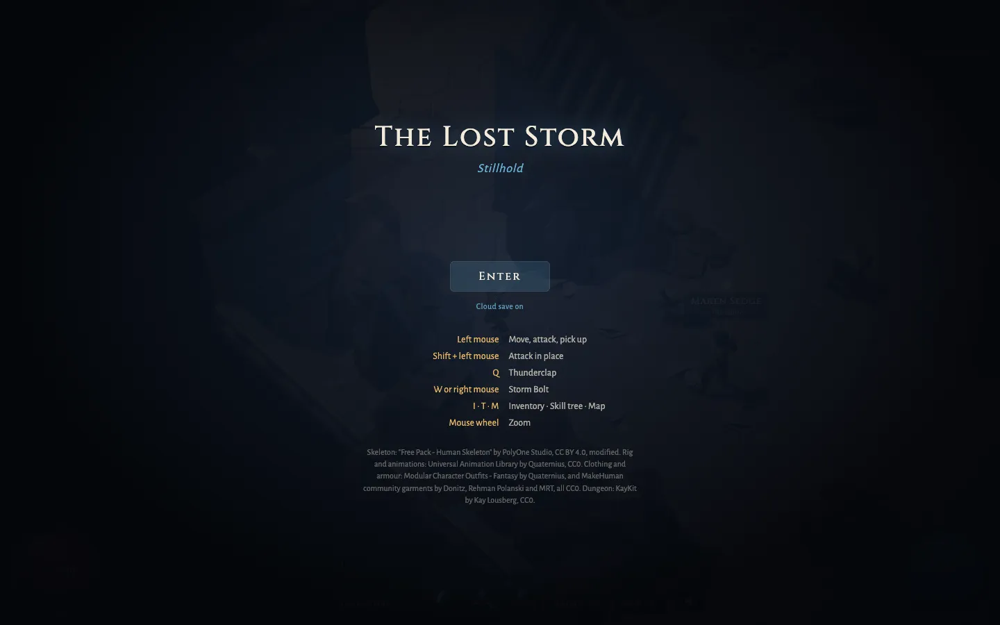
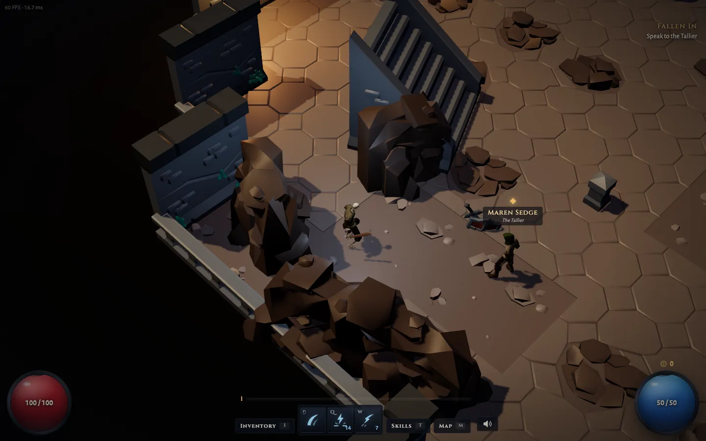
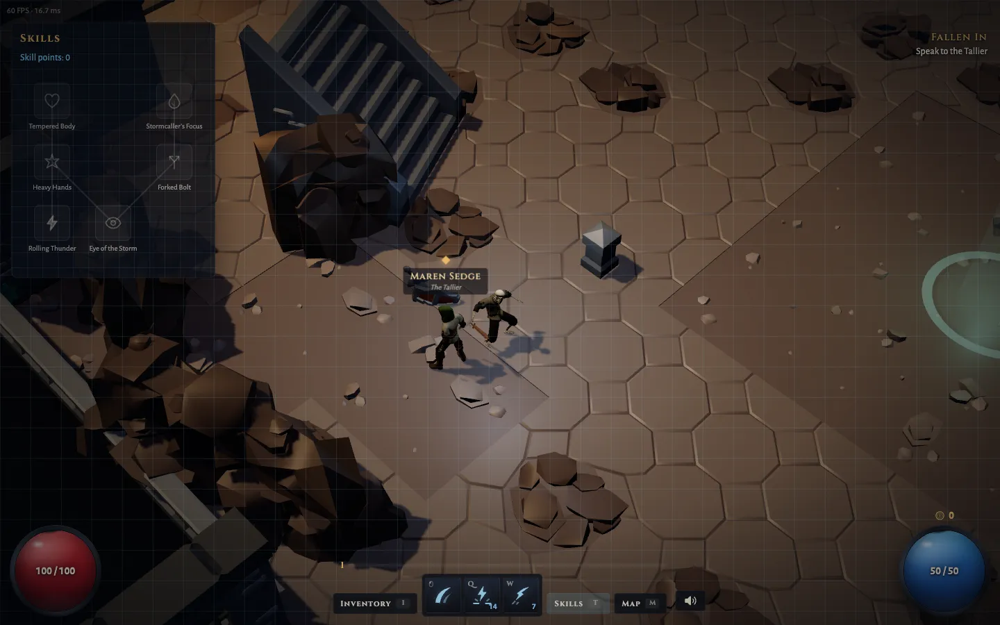

# The Lost Storm

A single-player isometric action RPG that runs in the browser. Three.js, TypeScript and Vite, with no game engine on top. The world is a set of zones joined by exits: a safe town (Stillhold) and the Drowned Bastion, an arena of endless surges. One hero, two monster types, loot, levelling and a small skill tree.

**Play it:** [theloststorm.com](https://theloststorm.com)







## Run it

```bash
npm install
npm run dev
```

Open http://localhost:5193.

| Input | Action |
|---|---|
| Left mouse | Move, attack the monster under the cursor, pick up loot, talk to the character under the cursor, travel through the exit under the cursor. Hold to keep going. |
| Left mouse, Space or Enter in a conversation | Next line |
| Shift + left mouse | Attack in place |
| Q | Thunderclap (area hit around you) |
| W or right mouse | Storm Bolt (projectile) |
| I / T / M | Inventory / skill tree / world map |
| Mouse wheel | Zoom |
| Escape | Close panels, leave a conversation |

Progress saves to `localStorage` on its own, including the zone you are in and where you last arrived or touched a checkpoint; dying returns you there. "Start over" on the title screen clears it.

The game ships a first act: a town, a road north and a road east of two zones each, with a boss off the main path of each, and a last zone behind the town's gate. It takes well under an hour. The plot is written down in `docs/story/`; do not open it before you have played.

## Cloud save (optional)

The game never needs a server. Progress saves to `localStorage`, and a plain clone makes no network request.

To keep a cloud copy of the character, point the client at a compatible save server with `VITE_SERVER_URL`:

```bash
VITE_SERVER_URL=http://localhost:8787 npm run dev
```

With the variable set:

- On first run the game creates a guest account on that server and keeps its token in `localStorage`, bound to that server's address. A guest account belongs to the browser that created it, so until the player signs in the cloud copy is a backup for this browser and does not follow them to another browser. Clearing only the save (`the-lost-storm.save.v1`) or using "Start over" keeps the link to the cloud copy. Clearing all site data removes the token too: the next start creates a new guest account and the old cloud copy is left behind.
- On load it takes the newer of the local and the cloud save. If both changed since they last met, the one with the higher level, then the higher experience, wins. The browser console says which one was kept and why.
- Every local save is also pushed in the background and retried quietly. A slow, missing or misbehaving server never fails the game. When a server asks for a wait with `Retry-After`, the client honours it only if the server exposes that header to browsers (`Access-Control-Expose-Headers: Retry-After`); otherwise it backs off on its own. At start the game waits three seconds at most for the cloud copy, which loads alongside the characters, and "Start over" waits up to three seconds for the cloud before it reloads.
- "Start over" resets the cloud copy as well.

If the server offers Sign in with Google, the title screen shows Google's sign-in button under the cloud line. Signing in as a guest keeps the character: the server links Google to the same account. Signing in on another browser switches that browser to the account, and the account's cloud save is loaded there (a browser whose account has no cloud save yet uploads its own). "Sign out" forgets the account and this browser's copy of the save and starts a fresh guest; it waits until the latest progress has reached the cloud. The page reloads after signing in or out. Google's script is loaded only when the server says sign-in is on, and nothing from Google is requested otherwise.

The title screen shows "Cloud save on" or "Offline". Without the variable it always says "Offline". The requests the client makes, and the answers it accepts, are the types in `src/backend/api.ts`.

## Checks

There is no CI yet. Run this before every pull request; it must pass with zero errors:

```bash
npm run check
```

It runs `npm run typecheck` (strict TypeScript), `npm run lint` (oxlint with type information, rules in `.oxlintrc.json`) and `npm test` (Node's test runner; takes about a second). `npm run build` makes the production bundle in `dist/`.

## Layout

| Path | What it holds |
|---|---|
| `data/` | All content as JSON: skills, monsters, items, the skill tree, rigs, held gear, clothing and armour, props, the surfaces that ground and props are dressed in (`surfaces.json`), the player, the world (`world.json`), one file per zone in `data/zones/`, and which sound id plays for which event (`audio.json`) |
| `sim/` | The game itself in plain TypeScript: stats, combat, skills, monster behaviour, pathfinding, loot, progression, saving. No Three.js and no DOM, so it runs and is tested in Node |
| `sim/content/` | The content schema (`types.ts`) and the readers that check every JSON file at start-up |
| `sim/world/` | World state, the commands the player can send and the events each step returns (`types.ts`), and `stepWorld` (`step.ts`) |
| `src/render/` | Three.js: stage and lighting, the isometric camera, character loading, the zone view and its exit and checkpoint markers, the ground (`ground.ts`) and the shared surface materials (`surfaces.ts`), effects, weather, world-anchored overlays |
| `src/hud/` | DOM HUD: globes, skill bar, inventory, skill tree, volume panel, tooltips, the dialogue box, the quest tracker, the world map, the boss bar and the subtitle strip for lines spoken in a fight |
| `sim/bot.ts` | A scripted player for tests: walks, travels between zones, talks, fights and steps out of telegraphed attacks. `sim/bot.test.ts` uses it to play the whole act from a fresh save and checks how long it takes |
| `src/audio/` | Web Audio: loads sounds from the asset server, plays them with variation, distance and panning, keeps volumes, plays one voice line at a time |
| `src/voice.ts` | The voice hook the dialogue box calls for each line; `main.ts` connects it to the audio system |
| `docs/story/` | The story notes and every spoken line. They give the whole plot away; each file says so at the top |
| `src/save-events.ts` | Which events from a step mean the save has to be written. Its test plays the whole act and fails when a step changes the save without one |
| `src/input.ts` | Mouse and keyboard to commands |
| `src/main.ts` | Loads everything and runs the frame loop |
| `public/models/` | GLB models. Every file is listed in [ASSETS.md](ASSETS.md) |
| `public/textures/` | Colour, normal and roughness maps for the surfaces in `data/surfaces.json`. Every file is listed in [ASSETS.md](ASSETS.md) |
| `blender/` | Blender scripts that build models: weapons, clothing and armour converted from outfit packs to the shared rig, the walls, lamps, furniture and houses of the world (`build_environment.py`), and props converted from Poly Haven scans (`import_polyhaven.py`) |
| `tools/` | Node tools: `inspect-glb.ts` prints a GLB's meshes and clips, `build-characters.ts` trims a body and extracts the shared animation file, `retarget-clips.ts` moves clips from a rig with other joint names onto the shared rig (`combat-clips.json` lists which), `pack-gltf.ts` packs a `.gltf` with its buffers and textures into one `.glb` |
| `test/rules.test.ts` | Repository rules: no comments, no type escape hatches, `sim/` stays free of rendering code, every model is credited |

The renderer reads the world and the events `stepWorld` returns, and sends commands back. It never changes world state.

## Adding content

Content is data. None of these need a change to the game's logic; the one code edit is registering a new zone file in the content loader, described below:

- **A skill**: add an entry to `data/skills.json`. `delivery` picks how it hits: `arc` (melee sweep), `nova` (ring around the user) or `projectile`. `windup`, `recovery`, `cooldown` and `manaCost` set its timing and cost; `knockback`, `stagger`, `shake`, `hitStop` and `vfx` set how it feels. `animation` names an action clip on the rig of whoever uses it. An optional `combo` (`window`, `steps`) makes the skill a chain: used again within `window` seconds of the last swing ending, it plays the next step instead, and each step has its own `animation`, `windup`, `recovery`, `stagger`, `shake` and `hitStop` and scales the skill's damage, area and knockback (`damageScale`, `areaScale`, `knockbackScale`). The steps scale the skill as the tree has changed it and keep its id, so passives, cooldown and sounds apply to the whole chain. Put it on the bar in `data/player.json` (`skillBar`, with key bindings) or give it to a monster.
- **A monster**: add an entry to `data/monsters.json` with its `rig`, stats, `behaviour` (`chaser` or `ranged`), `skill` and `loot`, then add it to a pack in a zone file.
- **An item**: add a base, an affix or a rarity to `data/items.json`. Its `slot` is one of `weapon`, `head`, `chest`, `hands`, `legs`, `feet` and `charm`. A weapon base's `visual` names the rig attachment to show in the hero's hand; an armour base's `wear` lists the wearables it puts on the body.
- **Clothing or armour**: add an entry to `data/wearables.json` (see below) and name it in an item base's `wear`, or in the `wear` list of the player or a monster to dress them with nothing equipped.
- **A skill-tree node**: add an entry to `data/skill-tree.json` with its grid position, what it `requires`, and its `statMods` and `skillMods`.
- **A sound**: `data/audio.json` maps game events to sound ids: by skill id (`skillStart`, `skillImpact`, `skillHit`, `projectileSpawn`, `projectileExpire`), by monster id or `player` (`hit`, `critHit`, `death`, `aggro`), by rarity or `gold` (`drop`, `pickup`), `notice`, `world` (`hero_step`, `level_up`, `surge`, `monster_spawn` and others), `ui` actions, and `ambience` per zone id. Each entry can set `volume`, `maxVoices` (copies of that sound at once) and `cooldown`. The sound files themselves are not in this repository (see Sound below).
- **A character to talk to**: add an entry to `data/npcs.json` (`name`, `title`, its `rig`, `tint`, `color` and held `gear`, and its `talks`), put its lines in `data/lines.json` as `{ id, speaker, text }`, and place it in a zone's `npcs` list. `talks` is an ordered list of conversations; the one that plays is the first that is repeatable or has not been heard yet, so list `once` conversations first and end with a repeatable one. A line id is stable: it is also the name of that line's recording, so add a new id rather than renaming one. Every line must also appear in `docs/story/lines.md`.
- **A boss**: give a monster a `boss` block: a `title`, `phases` (each `{ below, skills, barks }`, where `below` is the life fraction at which the phase begins, the first being 1, and `skills` is a weighted list), `poise` (`knockback`: the fraction of knockback it takes; a boss is never staggered or interrupted), a guaranteed `drop` (`items`, `rarity`, `goldMin`, `goldMax`) and `barks` (`aggro`, `death`): line ids from `data/lines.json` whose `speaker` is the monster's id. Boss skills are ordinary skills; give them a `windup` long enough to walk out of, because every monster attack draws its area on the ground while it winds up. Place the boss in a zone pack, and give the pack a `when` condition (for example its quest objective being `current`) so it is not handed out again once beaten.
- **A quest**: add an entry to `data/quests.json`: a `name`, the quests it `requires`, and its `objectives` in order. An objective has an `id`, the `text` the tracker shows, and a `type`: `talk` (finish a conversation with `npc`), `reach` (stand in a circle in a `zone`) or `defeat` (kill a `monster` of that kind). Anything can depend on progress through one small condition, `{ "type": "quest", "quest", "is": locked | active | done }` or `{ "type": "objective", "quest", "objective", "is": pending | current | done }`: a conversation's `when`, an NPC placement's `when`, a pack's `when`, a prop's `when`, a zone voice's `when`, and an exit's `requires` (with a `lockedHint` shown when the exit is refused). Add `"not": true` to a condition to turn it round, for something that is there until an objective is done. Give every `talk` objective a `once` conversation whose `when` is that objective being `current`.
- **A waypoint**: give a zone a `waypoint` (`x`, `z`, `radius`, or `null` for none) and a place on the world map in `data/world.json` (`map`). Standing on a waypoint unlocks it; the map (M) then teleports between unlocked waypoints.
- **A zone**: add `data/zones/<id>.json`, then import it in `sim/content/content.ts` and add it to the `zones` list of `RAW_CONTENT` there (a test fails when a zone file is not loaded). A zone holds the tile map (4-unit cells), wall and floor models, prop placements, the player start, the monster packs and their `level`, its `kind` (`town` is safe and has no packs; `wild` has monsters), optional `surge` rules for endless surges, `checkpoints`, its `ambience` (fog, sky and key light) and its `exits`. An exit names the zone and the exit on the other side (`to`, `toExit`) and the `arrival` point where a hero coming through it stands; the two exits must name each other. `data/world.json` names the start zone and how monsters scale with level. A zone can also change with the story:
  - A prop with a `when` is drawn only while its condition holds, and its light eases in and out. It is never part of the walkable map, so it must not be a prop that blocks.
  - A pack with a `when` appears when its condition starts to hold, also while the hero is already in the zone, once per visit.
  - An exit with `"hiddenWhenLocked": true` has no marker, no label and no place on the world map until its `requires` holds.
  - `voices` are spoken lines tied to a place: `{ id, x, z, radius, lines, when }`. The first time the hero steps into the circle the lines play as subtitles without stopping the game, once per save. A voice id must not be the id of a conversation.
  - Keep packs away from the start, arrival points, checkpoints and the waypoint: a test fails when a pack notices the hero standing on one of them.

If something cannot be expressed in the data, extend the schema in `sim/content/` in a general way first. See [AGENTS.md](AGENTS.md).

## Characters and gear

Every humanoid shares one rig (the Quaternius Universal Animation Library rig), so a body, a clip and a piece of held gear each exist once and work on every character.

A character is a rig entry in `data/rigs.json`. The loader (`src/render/character-loader.ts`) needs nothing else.

```json
{
  "id": "skeleton_hero",
  "url": "models/characters/skeleton.glb",
  "animationUrls": ["models/animations/humanoid.glb", "models/animations/combat.glb"],
  "scale": 1.2,
  "yawOffsetDegrees": 0,
  "height": 1.85,
  "rootMotionBone": null,
  "runSpeed": 6.4,
  "clips": {
    "idle": "Sword_Idle",
    "run": "Jog_Fwd_Loop",
    "hit": ["Hit_Chest", "Hit_Head"],
    "death": ["Death01", "Death_Knockback", "Death_Collapse"],
    "actions": {
      "attack": { "clip": "Sword_Combo_A", "impactFraction": 0.18 },
      "attack_b": { "clip": "Sword_Combo_B", "impactFraction": 0.17 },
      "slam": { "clip": "Sword_Slam", "impactFraction": 0.245 },
      "cast": { "clip": "Spell_Simple_Shoot", "impactFraction": 0.35 }
    }
  },
  "sockets": {
    "hand_r": { "bone": "DEF-hand.R", "position": [-0.03, 0.085, 0], "rotationDegrees": [90, 90, 0], "scale": 1 }
  },
  "hiddenNodes": [],
  "bodyParts": {
    "feet": ["DEF-foot.L", "DEF-toe.L", "DEF-foot.R", "DEF-toe.R"]
  }
}
```

- `url` is the body. `animationUrls` lists GLB files whose clips are merged in, so one animation file serves every body on the same rig.
- `clips` names the clips in those files. `idle` and `run` are one clip each. `hit` and `death` are lists, and one is picked at random each time, so a pack does not fall the same way. `actions` is the set of attack clips this rig can play, under names of your choosing: a skill's `animation` (and each combo step's) is one of those names, and the content check reports a skill given to a character whose rig lacks it. `impactFraction` is the point in the clip where the blow lands; the game speeds the clip up or down so that point meets the skill's `windup`, then plays the rest over the `recovery`. If a clip name is wrong, the error lists the clips the files do contain.
- `runSpeed` is the ground speed the `run` clip matches at normal playback, so feet do not slide when a character is slower or faster.
- `rootMotionBone` pins that bone's horizontal movement so a clip with root motion plays in place.
- `sockets` are named mounting points: a bone plus an offset, rotation and scale.
- `hiddenNodes` are nodes in the body file that are never shown.
- `bodyParts` names groups of joints. The body's triangles skinned mostly to a group can be left undrawn while a wearable covers them.

Held gear is an entry in `data/attachments.json`: an id, a model file and the socket it mounts on. An item base's `visual`, the player's `gear` and a monster's `gear` name attachment ids, so a new weapon model is one GLB and one line of data. Weapon models are authored with the grip at the origin and the blade along +Y. `tint` on the player and on each monster recolours the body, so one body file makes several characters. `color` tints that character's effects and its body's emissive map (glowing eyes, runes) when the body has one; a body without an emissive map does not glow.

Clothing and armour are wearables: skinned meshes in `public/models/wear/` that are bound to the wearer's own skeleton by joint name, so each piece is made once, fits every character on the rig and bends with every clip. An entry in `data/wearables.json` has:

```json
{ "id": "leather_boots", "model": "models/wear/ranger_boots.glb", "region": "feet", "tint": "#f0e8d8", "hides": ["feet"] }
```

- `region` is the part of the body it covers: `head`, `shoulders`, `chest`, `arms`, `hands`, `legs` or `feet`. A character shows one piece per region. Its own clothes (`wear` on the player or a monster) come first, and each equipped item's pieces replace whatever covers the same region (`sim/wear.ts`).
- `tint` multiplies the piece's colour, so one model gives a clean shirt, a dirty one and a monster's rags.
- `hides` lists the wearer's `bodyParts` that are not drawn under it, so bone does not poke through a boot.

New pieces come from outfit packs through `blender/build_wearables.py`, which refits a part to our rig and writes one GLB per part. It reads rigged glTF parts (the Quaternius outfits) and MakeHuman garments. [ASSETS.md](ASSETS.md) has the command.

An armour base also names its `material`: `cloth`, `leather`, `mail` or `plate`. Within a slot a heavier material gives more armour, turns up later and less often, and mail and plate slow the wearer; `sim/items.test.ts` holds the data to that.

To use a different rig, add its rig entry with its own bone names in `sockets`, and point `data/player.json` (`rig`) or a monster at it. Mixamo characters work this way (export FBX, convert to GLB, set `scale` to 0.01 and `rootMotionBone` to `mixamorigHips`), but Mixamo files may not be redistributed, so they go in `public/models/local/`, which is git-ignored, and never in this repository.

## Sound

The game has sound, but this repository holds no sound file. The sound effects are licensed for use inside the game and may not be handed out as files, so they live in a private repository and are served by a separate server.

- The client reads `VITE_ASSET_BASE`. When it is not set, the game makes no request and plays nothing. **A fresh clone of this repository runs silent**; nothing is missing or broken.
- When it is set, for example `VITE_ASSET_BASE=http://localhost:5210/`, the game fetches `manifest.json` from that base after you press Enter (browsers only start audio after a click) and then the sounds it needs, one at a time as they are first used. The manifest maps sound ids to files: `{ "sfx": { "<sound id>": ["path.ogg", ...] }, "voice": { "<line id>": "path.mp3" } }`. A sound id that is not in the manifest, or a file that fails to load or decode, plays nothing and throws nothing.
- A sound that has not started within 0.6 s of being wanted (`latePlaySeconds` in `src/audio/system.ts`; the window includes any wait for the manifest or for a warm-up of the same file) is dropped rather than played late. The manifest is fetched again, and ambience loops that could not start are tried again, while the game runs; once the manifest is loaded the one-shot sounds named in `data/audio.json` are decoded in the background so the first plays are ready.
- `data/audio.json` only names sound ids; it never contains a path.
- The owner starts the asset server from the private assets checkout with `npm run serve` (port 5210, CORS for `http://localhost:*`). To hear the game locally, put `VITE_ASSET_BASE=http://localhost:5210/` in `.env.local` (git-ignored) and restart `npm run dev`.
- The speaker button next to the menu buttons opens master, effects, voice and ambience sliders and a mute switch. They are kept in `localStorage`.
- `playVoice(lineId)` on the audio system (`window.storm.audio` in a dev build) plays a spoken line, lowers the effects while it plays and resolves when the line ends, or at once if there is no such line.
- In a dev build `window.storm.sounds` lists the most recent sound ids as they are triggered (with their distance gain and pan), whether or not a base is set, so the mapping can be checked without hearing anything.

## Assets and licence

The code, and the models made for this project, are under the MIT licence: see [LICENSE](LICENSE). Third-party assets keep their own licences; every shipped asset is listed with its source and licence in [ASSETS.md](ASSETS.md), and the licence texts are in `licenses/`.

Sounds are not in this repository, because their licence does not allow redistributing the files. The game runs silent from a clone.

The name "The Lost Storm" and its logo are not covered by the licence.
